# Improving MARL Robustness for Agent Blindness in VMAS

A Multi-Agent Reinforcement Learning research project investigating how cooperative agents handle partial observability through random "blindness" events. This work demonstrates that MARL systems can learn robust coordination strategies despite unpredictable sensory failures.

[](https://www.python.org/downloads/)
[](https://pytorch.org/)


## 🎯 Overview

**The Challenge:** Autonomous systems must cooperate effectively even when sensors fail unexpectedly. This project explores whether multi-agent reinforcement learning can develop strategies that remain robust when agents randomly lose sensory input.

**Key Innovation:** Six custom blindness scenarios implemented as VMAS environment transforms, ranging from simple single-step occlusions to complex multi-agent, variable-duration sensory failures.

**Results:** Every experiment has been re-run with the fixed code over 3 seeds, and a new robustness test evaluates trained policies on separate episodes. The headline: **training with blindness makes the team markedly more robust, once it has trained long enough.** After 100 iterations, a team trained with each-agent blindness keeps 86% of its reward at 10% blindness, against 43% for a team trained without it, and loses nothing when no one is blind. At 25 iterations it hadn't caught up yet.

### Results at a glance

| Question | Answer (3 seeds, fixed code) | Details |
|---|---|---|
| Does training with blindness make a team more robust? | Yes, after 100 iterations: 86% vs 43% of reward kept at 10% blindness. After 25 iterations, no | [Robustness test](#robustness-test) |
| How much does blindness cost? | Depends on how agents go blind: one at a time costs little, all at once prevents learning | [Experiment 1](#experiment-1-re-run-with-the-fixed-code) |
| Do longer blind spells hurt? | Steadily; steeply when every agent can go blind (22% of reward kept with spells up to 20 steps) | [Experiment 7](#experiment-7-re-run-blind-spell-length) |
| Do bigger teams cope better? | Yes: one blind agent costs 3 agents about half their reward, 7 agents nothing. No 5–7 sweet spot | [Experiment 8](#experiment-8-re-run-team-size) |
| Is advantage normalization essential? | No: it made seeds agree more, not scores higher | [Experiment 2](#experiment-2-re-run-advantage-normalization) |
| Which PPO settings help? | Clip 0.3, smaller minibatches and more epochs; the defaults undertrain in 25 iterations | [Experiments 3–5](#experiments-3-5-re-run-clip-value-minibatch-size-epochs) |
| Does tuning give +86%? | About +32%, and the reported best combination isn't the best | [Hyperparameter re-run](#hyperparameter-re-run) |
| Does it carry over to other VMAS scenarios? | Blindness works in all five. Where agents learn, it costs 6–16% after 100 iterations (more at 25, mostly from slower learning); wheel and ball_passage don't learn even then | [Scenarios](#vmas-scenarios-re-run) |


### Real-World Applications

- **Autonomous vehicles** handling camera/sensor malfunctions
- **Drone swarms** maintaining formation during GPS signal loss
- **Robot teams** completing tasks with failed sensors
- **Satellite networks** coordinating during communication blackouts

## 🔬 Research Highlights

### Custom Blindness Scenarios

Implemented six environment transforms that randomly zero out agent observations:

1. **BlindOneRandomAgentEveryStep** - One agent blinded each step
2. **BlindAllAgentsEveryStep** - All agents simultaneously blinded
3. **BlindOneRandomAgentIfProbability** - Probabilistic single-agent blindness
4. **BlindRandomAgentsIfProbability** - Probabilistic multi-agent blindness
5. **BlindOneRandomAgentIfProbabilityForJSteps** - Extended duration single-agent blindness
6. **BlindRandomAgentsIfProbabilityForJSteps** - Extended duration multi-agent blindness (most realistic)

### Key Findings

The findings below come from the original single-seed runs, before the bug fixes described in "Known issues and status". The re-runs and the robustness test (see "Experimental Results") qualify all five points.

- **Robustness is learnable**: Confirmed by the robustness test, given enough training. After 100 iterations, policies trained with blindness score as well as the no-blindness policy when nobody is blind, and much better when agents are (see "Robustness test"). After only 25 iterations they were still behind
- **Hyperparameters matter**: The original runs reported +86% for normalized advantages, clip=0.3, batch=100, epochs=30. The re-run finds a smaller, noisier gain, and that configuration isn't the best one tested (see "Hyperparameter re-run")
- **Advantage normalization is critical**: Not supported by the re-run. At the experiments' 25 iterations it made no consistent difference to final reward, though it did make seeds agree more (see "Experiment 2 re-run")
- **Redundancy helps**: Confirmed by the re-run with a no-blindness control: a 3-agent team loses about half its reward to one blind agent, a 5-agent team about a fifth, and from 7 agents nothing. The original "5-7 agents is optimal" isn't: 10 agents scored highest, with no sign of coordination overhead (see "Experiment 8 re-run")
- **Performance thresholds exist**: Partly. The threshold depends on how agents go blind: with one agent blind at a time, policies keep most of their reward even at 50% blindness, but when every agent can go blind independently, performance drops sharply from 10-20% (see "Robustness Thresholds")

## Known issues and status

The original results (the tables further down) were produced with code that had several bugs, all now fixed:

- `BlindAllAgentsEveryStep` picked a random agent (with replacement) on each loop pass, so it blinded about two of three agents, not all of them.
- `BlindRandomAgentsIfProbability` blinded a fresh random agent, not the agent that passed the probability check.
- `BlindRandomAgentsIfProbabilityForJSteps` ignored `max_blind_steps` and always drew durations from 1 to 10.
- Every transform made one random choice per step and applied it to all 30 parallel environments at once, kept blind countdowns per agent rather than per environment, and never reset them between episodes. The transforms now live in `blindness.py`, draw independently per environment, and are covered by tests in `tests/`.
- The blindness-probability and blind-duration sweeps wrapped the previous iteration's environment, so transforms stacked up across settings. Each setting now starts from a fresh base environment.
- The first plot read a `"norm"` key that its results did not have, so the script crashed after the first experiment.
- The "VMAS Scenarios" experiment could crash with "Physical actions ... out of its range": a `TanhNormal` sample can overshoot the action bound by floating-point error, which VMAS rejects. The policy now clamps actions into the spec (`safe=True`).

With these fixes, every experiment in the script has been run end to end with a reduced training budget (1 iteration each) to check that it completes.

Experiments 1-5, 7, 8 and the hyperparameter comparison have been re-run with the fixed code over 3 seeds (below). Experiment 6 (blindness probability) is answered by the robustness test, which evaluates trained policies on separate episodes across blindness probabilities. The VMAS scenarios experiment has been re-run too, with a no-blindness control per scenario. Most re-runs keep the original 25 training iterations, at which most reward curves are still rising; the robustness test and Experiment 7 use 100.

The reward rescaling in the blindness-probability and blind-duration plots is applied for display only, so those curves cannot be compared directly across settings.

## 📊 Experimental Results

### Experiment 1, re-run with the fixed code

Final episode reward (mean over the 30 parallel environments, last training iteration), mean ± standard deviation over 3 seeds. Same settings as the original experiment: `norm=False`, clip 0.2, 25 iterations × 6,000 frames, balance scenario with 3 agents.

| Blindness Scenario | Final Reward |
|-------------------|--------------|
| No blindness (baseline) | 49.2 ± 4.8 |
| Blind 1 random agent with probability 0.1 | 40.5 ± 11.6 |
| Blind each agent with probability 0.1 | 37.8 ± 15.6 |
| Blind 1 random agent for 1–10 steps (probability 0.1) | 34.2 ± 16.1 |
| Blind each agent for 1–10 steps (probability 0.1) | 10.7 ± 9.2 |
| Blind 1 random agent every step | 5.5 ± 12.9 |
| Blind all agents every step | −11.8 ± 1.9 |

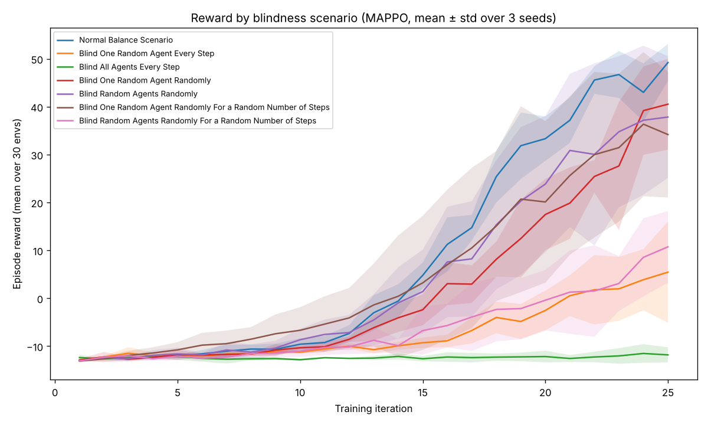

What holds up: training without blindness does best, and blinding every agent prevents learning entirely. Occasional, short blindness costs relatively little, while persistent blindness (every step, or several agents for several steps) hurts much more. The spread between seeds is as large as the gaps between the middle scenarios, so their order isn't meaningful from 3 seeds.

These rewards are on a different scale from the original table below (about 50 rather than about 450 for the baseline). The re-run used the pinned versions in `requirements.txt`; the original runs may have used different library versions or reported reward differently.

To reproduce: `python experiments/run_exp1.py . <seed> experiments/seed<seed>.json` for each seed (about 45 minutes per seed on one CPU core), then `python experiments/plot_exp1.py`. The results used here are in `experiments/exp1_results.json`.

### Experiment 2 re-run: advantage normalization

The original runs concluded that advantage normalization is essential under blindness (+40–60 reward). Experiment 1's re-run above trained with normalization off; repeating it with normalization on, with the same seeds and settings otherwise, tests that claim. Final reward, mean ± std over 3 seeds:

| Scenario | Normalization off | Normalization on |
|---|---|---|
| Normal (no blindness) | 49.2 ± 4.8 | 43.8 ± 10.9 |
| Blind 1 random agent every step | 5.5 ± 12.9 | 16.6 ± 6.0 |
| Blind all agents every step | −11.8 ± 1.9 | −10.8 ± 2.4 |
| Blind 1 random agent with probability 0.1 | 40.5 ± 11.6 | 36.8 ± 8.0 |
| Blind each agent with probability 0.1 | 37.8 ± 15.6 | 33.2 ± 6.3 |
| Blind 1 random agent for 1–10 steps | 34.2 ± 16.1 | 21.3 ± 7.6 |
| Blind each agent for 1–10 steps | 10.7 ± 9.2 | −0.2 ± 5.9 |

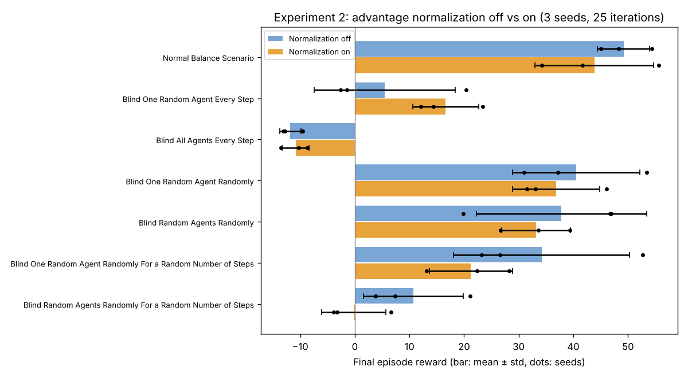

Normalization isn't essential here. With it on, the mean is lower in 5 of 7 scenarios, and the per-seed differences mostly change sign. Its one consistent gain is with one agent blinded every step (+11, better in all 3 seeds). What it does do is make seeds agree more: the spread is smaller in 5 of 7 scenarios. Repeated runs reproduce exactly (the no-blindness, normalization-on results match the robustness test's), so these differences are between seeds, not run-to-run noise.

To reproduce: `python experiments/run_exp1.py . <seed> experiments/norm_seed<seed>.json norm` for each seed, merge the seed files into `experiments/exp2_norm_results.json`, then `python experiments/plot_exp2.py`.

### Original results (before the fixes)

| Blindness Scenario | Final Reward | Performance vs. Baseline |
|-------------------|--------------|--------------------------|
| No blindness (baseline) | ~450 | 100% |
| Blind 1 agent randomly (1 step) | ~380 | 84% |
| Blind 1 agent every step | ~320 | 71% |
| Blind 1 agent random duration | ~280 | 62% |
| Blind random agents randomly | ~240 | 53% |
| Blind random agents random duration | ~180 | 40% |

### Hyperparameter Optimization

**Impact of Key Parameters:**
- **Normalization**: Essential (+40-60 reward improvement across scenarios). *Not supported by the 3-seed re-run; see "Experiment 2 re-run".*
- **Clip value**: Optimal at 0.3 (+28% over default 0.2). *The re-run agrees 0.3 is best of those tested, by more; see "Experiments 3-5 re-run".*
- **Batch size**: Smaller batches (50-100) outperform default 200. *Supported by the re-run.*
- **Epochs**: Diminishing returns after 30 epochs. *Not supported: 50 epochs scored highest in the re-run.*
- **Agent count**: 5-7 agents optimal for robustness vs. coordination. *Not supported by the 3-seed re-run; see "Experiment 8 re-run".*

**Configuration reported as best in the original runs:**
```python
normalize_advantage = True
clip_epsilon = 0.3
minibatch_size = 100
num_epochs = 30
# Original single-seed result: ~520 reward (+86% over baseline 280)
```

### Hyperparameter re-run

The comparison above was re-run with the fixed code: 3 seeds per setup, on the scenario where one random agent is blinded for 1–10 steps with probability 0.1. "Best" is the configuration above; the last three rows each revert one of its changes.

| Setup | Normalize | Clip | Batch | Epochs | Final reward (mean ± std) | Seeds |
|-------|-----------|------|-------|--------|---------------------------|-------|
| Original | False | 0.2 | 200 | 20 | 34.2 ± 16.1 | 23.3, 26.6, 52.7 |
| Best | True | 0.3 | 100 | 30 | 45.3 ± 6.8 | 53.2, 41.8, 41.0 |
| Best, but clip 0.2 | True | 0.2 | 100 | 30 | 46.1 ± 10.7 | 36.9, 57.9, 43.5 |
| Best, but batch 200 | True | 0.3 | 200 | 30 | 55.6 ± 1.8 | 55.8, 53.7, 57.2 |
| Best, but 20 epochs | True | 0.3 | 100 | 20 | 52.4 ± 6.8 | 50.9, 59.8, 46.4 |

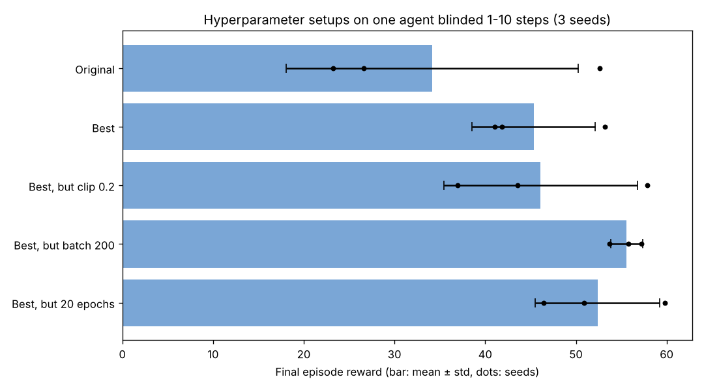

What holds up: every tuned setup beats the original settings on average (+32% for "Best") and varies much less between seeds. What doesn't: the +86% figure, and the claim that batch 100 and 30 epochs are optimal. Going back to batch 200 or to 20 epochs did as well or better, and with 3 seeds the differences between the tuned setups are within noise.

To reproduce: `python experiments/run_tuning.py . <seed> experiments/tuning_seed<seed>.json` for each seed (about 50 minutes per seed on one CPU core), merge the seed files into `experiments/tuning_results.json`, then `python experiments/plot_tuning.py`.

### Experiments 3-5 re-run: clip value, minibatch size, epochs

The original sweeps changed one PPO setting at a time on the one-agent, 1–10-step blindness scenario, with normalization on. The re-run does the same with 3 seeds and four values per setting (the default is clip 0.2, batch 200, 20 epochs):

| Setting | Values (mean final reward ± std) |
|---|---|
| Clip value | 0.1: −3.5 ± 5.0 · **0.2: 21.3 ± 7.6** · 0.3: 45.2 ± 10.0 · 0.5: 30.8 ± 30.0 |
| Minibatch size | 50: 42.3 ± 6.1 · 100: 38.8 ± 19.9 · **200: 21.3 ± 7.6** · 500: 14.5 ± 19.8 |
| Epochs | 10: 4.6 ± 10.6 · **20: 21.3 ± 7.6** · 30: 40.5 ± 9.2 · 50: 49.9 ± 3.6 |

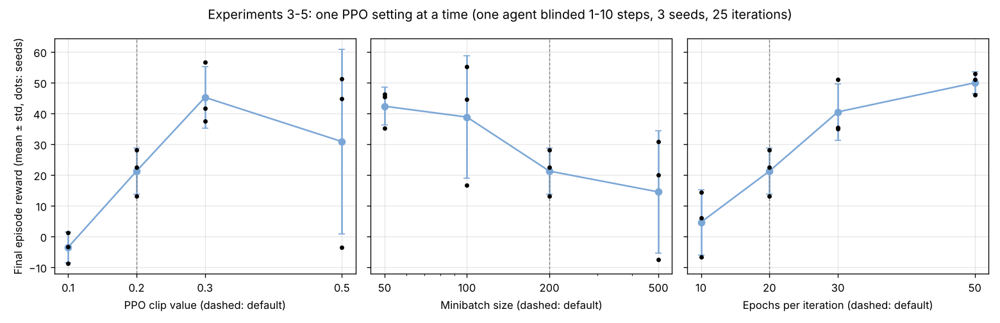

- **Clip 0.3 is best of those tested** (about double the default), as the original found. 0.1 doesn't learn, and 0.5 varies wildly between seeds.
- **Smaller minibatches do better**, as the original found: 50 and 100 beat the default 200.
- **More epochs keep helping.** The original reported diminishing returns after 30; here 50 epochs scored highest and was the most consistent across seeds.
- **The common thread:** every change that helped means more or bigger policy updates per iteration (smaller minibatches, more epochs, a wider clip). With only 25 iterations, the default settings undertrain. The robustness test points the same way: results changed a lot between 25 and 100 iterations.
- These are one-at-a-time changes from the default. In the hyperparameter re-run, which changed several settings together, clip 0.2 and 0.3 did about the same.

To reproduce: run `python experiments/run_sweep.py . <seed> <out.json> <clip> <batch> <epochs>` for each setting and seed (one short run each, so many can go in parallel), then `python experiments/plot_sweep.py <folder of outputs>`. The default-setting runs are the robustness test's 25-iteration one-agent runs (repeat runs reproduce exactly), so the plot script takes them from `robustness_results.json`.

### Experiment 7 re-run: blind spell length

The original experiment retrained a policy for each maximum blind duration and scored it on its own training rollouts. The re-run trains two policies per seed for 100 iterations, one without blindness and one with one-agent blindness (1–10 steps, probability 0.1). It then evaluates each on separate episodes at blindness probability 0.1, with maximum blind spells from 1 to 20 steps:

| Trained with | Evaluated with | No blindness | 1 step | 3 | 5 | 10 | 20 |
|---|---|---|---|---|---|---|---|
| No blindness | One agent blind | 69.7 ± 2.5 | 69.2 ± 1.9 | 66.3 ± 1.9 | 64.5 ± 2.2 | 59.7 ± 5.7 | 55.9 ± 8.7 |
| One agent blind | One agent blind | 72.3 ± 4.6 | 68.9 ± 2.7 | 68.1 ± 2.6 | 66.7 ± 2.9 | 65.4 ± 3.8 | 61.8 ± 5.6 |
| No blindness | Each agent blind | 69.7 ± 2.5 | 67.6 ± 4.2 | 56.2 ± 8.8 | 47.3 ± 14.2 | 30.0 ± 21.3 | 15.0 ± 18.1 |
| One agent blind | Each agent blind | 72.3 ± 4.6 | 68.8 ± 5.3 | 64.9 ± 5.7 | 61.0 ± 5.8 | 51.5 ± 7.5 | 35.4 ± 8.6 |

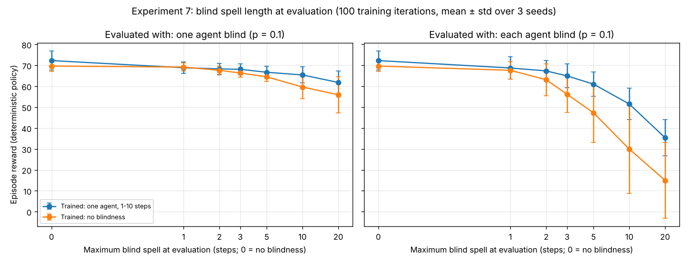

- **Longer blind spells hurt, steadily.** With one agent blind at a time the decline is gentle (the no-blindness policy keeps 80% of its reward even with spells of up to 20 steps). When every agent can go blind, it's steep: 68% at 5 steps, 43% at 10, 22% at 20.
- **Training with blindness helps more as spells get longer**, and it carries beyond what was trained on: trained on spells of up to 10 steps, the policy keeps 49% at 20 steps against 22% without blindness training.
- The original's "1–5 steps minimal, 7–10 moderate, 20+ severe" roughly matches each-agent blindness, but not one-agent blindness, which stays mild throughout.

To reproduce: `python experiments/run_duration.py . <seed> <out.json> <none|one> 100 [policy.pt]` for each seed and condition (about 13 minutes each), then `python experiments/plot_duration.py <folder of outputs>`.

### Experiment 8 re-run: team size

The original runs found that 5–7 agents are optimal, with 10 agents doing worse from coordination overhead. But in the balance scenario more agents also make the task itself easier, so raw reward can't show whether a bigger team copes better with blindness. The re-run trains each team size both with and without blindness (one random agent blinded for 1–10 steps, probability 0.1, the original setting), 3 seeds each:

| Agents | No blindness | With blindness | Share kept |
|---|---|---|---|
| 2 | 7.4 ± 19.5 | 13.9 ± 12.2 | (didn't learn in 25 iterations) |
| 3 | 43.8 ± 10.9 | 21.3 ± 7.6 | 48% |
| 5 | 76.7 ± 5.0 | 62.4 ± 5.2 | 81% |
| 7 | 81.5 ± 2.9 | 91.9 ± 3.3 | 113% |
| 10 | 94.5 ± 8.9 | 95.5 ± 6.4 | 101% |

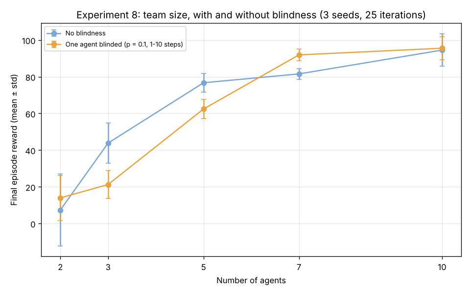

- **Redundancy helps.** The share of reward kept under blindness rises with team size: about half for 3 agents, about four fifths for 5, and all of it from 7. With 7 agents the blinded runs even scored higher, in all 3 seeds.
- **There's no sweet spot at 5–7.** 10 agents scored highest with and without blindness. Within this range, more agents only helped.
- **Two agents don't learn the task within 25 iterations**, with or without blindness, so their share kept isn't meaningful.

To reproduce: `python experiments/run_agents.py . <seed> experiments/agents_seed<seed>.json` for each seed (about 35 minutes per seed on one CPU core), merge the seed files into `experiments/exp8_agents_results.json`, then `python experiments/plot_exp8.py`.

### VMAS scenarios re-run

The original experiment trained the one-agent blindness setting (1–10 steps, probability 0.1) on five VMAS scenarios, without a no-blindness control, so it couldn't separate the cost of blindness from how hard each scenario is. The re-run trains each scenario with and without blindness, 3 seeds each, with the default settings and 25 iterations. Two details the original missed: `give_way` and `ball_passage` always have 2 agents and `multi_give_way` 4, whatever `n_agents` is set to.

| Scenario | Agents | No blindness | With blindness | Learned in 25 iterations? |
|---|---|---|---|---|
| balance | 3 | 43.8 ± 10.9 | 21.3 ± 7.6 | Yes |
| give_way | 2 | 3.97 ± 0.05 | 3.66 ± 0.01 | Yes |
| multi_give_way | 4 | −1.42 ± 3.17 | 4.11 ± 2.07 | Partly, unstable |
| wheel | 3 | −9.21 ± 0.57 | −9.29 ± 0.24 | No |
| ball_passage | 2 | −0.01 ± 0.02 | 0.03 ± 0.03 | No |

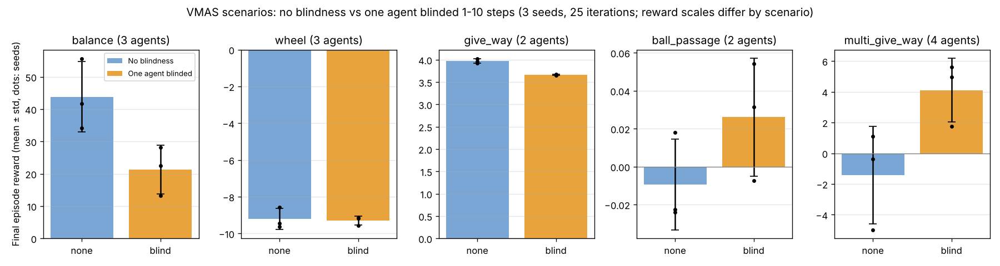

- **The blindness transforms work in every scenario.** They run without errors and train in all five.
- **Where agents learn, blindness costs them, by very different amounts.** Balance loses about half its reward; give_way loses 8%, a small effect but consistent across seeds.
- **wheel and ball_passage don't learn at all in 25 iterations**, with or without blindness: reward barely moves from the first iteration. They say nothing about blindness until they're trained longer or tuned.
- **multi_give_way is too unstable to call.** The no-blindness runs ranged from −5 to +1 across seeds.

**With 100 training iterations** (4× longer, same seeds):

| Scenario | Agents | No blindness | With blindness | Cost of blindness |
|---|---|---|---|---|
| balance | 3 | 64.0 ± 1.0 | 60.5 ± 2.3 | 6% (52% at 25 iterations) |
| give_way | 2 | 4.45 ± 0.39 | 3.72 ± 0.07 | 16% (8% at 25 iterations) |
| multi_give_way | 4 | 0.19 ± 3.09 | 2.89 ± 0.48 | None; the blinded runs are higher and steadier, but the no-blindness runs vary too much to call |
| wheel | 3 | −8.57 ± 0.61 | −8.62 ± 0.34 | None measurable; barely learns either way |
| ball_passage | 2 | 0.01 ± 0.04 | −0.01 ± 0.02 | None measurable; doesn't learn |

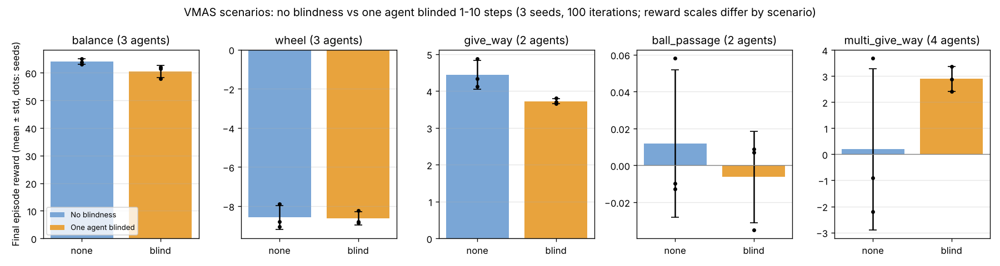

- **Most of balance's cost at 25 iterations was slower learning.** Trained 4× longer, the blinded team gets within 6% of the unblinded one, which matches the robustness test.
- **In give_way the cost grows with training** (8% → 16%): the unblinded team keeps improving and the blinded one doesn't.
- **wheel and ball_passage don't learn even with 4× the training.** Their rewards are sparse, so they likely need different settings or reward shaping rather than more iterations, before they can show anything about blindness.

To reproduce: `python experiments/run_scenarios.py . <seed> <out.json> <scenario> <none|one> [n_iters]` for each scenario, condition and seed, then `python experiments/plot_scenarios.py [--100] <folder of outputs>`. Balance comes from the robustness test's identical runs.

### Robustness test

The experiments above score each policy on its own training rollouts, in the conditions it was trained in. That can't say whether training *with* blindness makes a team more robust *to* blindness. This test does:

1. Train three policies (3 seeds each, the training function's default settings): with no blindness, with one random agent blinded for 1–10 steps (probability 0.1), and with each agent independently blinded for 1–10 steps (probability 0.1).
2. Evaluate every policy with deterministic actions on fresh, separately seeded environments, at blindness probabilities from 0 to 0.5, for both kinds of blindness (90 episodes per point).

It was run twice: with the script's 25 training iterations, then with 100.

**After 100 training iterations** (mean episode reward ± std over 3 seeds):

| Trained with | Evaluated with | p = 0 | 0.05 | 0.1 | 0.2 | 0.3 | 0.5 |
|---|---|---|---|---|---|---|---|
| No blindness | One agent blind | 69.7 ± 2.5 | 64.5 ± 1.8 | 59.7 ± 5.7 | 54.4 ± 8.9 | 48.2 ± 13.6 | 43.2 ± 16.9 |
| One agent blind | One agent blind | 72.3 ± 4.6 | 66.8 ± 3.9 | 65.4 ± 3.8 | 62.7 ± 4.5 | 60.9 ± 4.2 | 58.2 ± 7.1 |
| Each agent blind | One agent blind | 71.8 ± 2.6 | 69.7 ± 1.6 | 69.5 ± 0.9 | 67.7 ± 1.6 | 67.4 ± 2.9 | 65.0 ± 3.7 |
| No blindness | Each agent blind | 69.7 ± 2.5 | 49.0 ± 13.2 | 30.0 ± 21.3 | 15.4 ± 20.2 | 6.7 ± 15.6 | −1.9 ± 9.3 |
| One agent blind | Each agent blind | 72.3 ± 4.6 | 62.3 ± 6.3 | 51.5 ± 7.5 | 32.2 ± 11.6 | 16.0 ± 6.4 | 3.4 ± 2.6 |
| Each agent blind | Each agent blind | 71.8 ± 2.6 | 66.7 ± 4.4 | 61.7 ± 4.5 | 43.1 ± 8.5 | 20.2 ± 10.0 | 5.7 ± 1.4 |

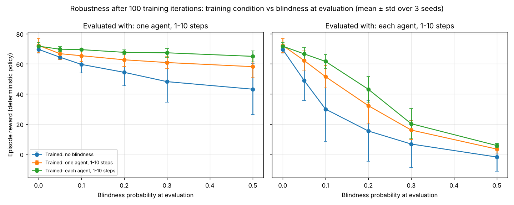

**After 25 training iterations:**

| Trained with | Evaluated with | p = 0 | 0.05 | 0.1 | 0.2 | 0.3 | 0.5 |
|---|---|---|---|---|---|---|---|
| No blindness | One agent blind | 56.3 ± 12.9 | 53.2 ± 11.1 | 51.6 ± 10.3 | 47.5 ± 9.5 | 44.7 ± 10.4 | 41.1 ± 12.0 |
| One agent blind | One agent blind | 38.5 ± 12.3 | 40.4 ± 12.6 | 41.3 ± 13.0 | 41.5 ± 13.6 | 39.6 ± 12.8 | 35.9 ± 13.3 |
| Each agent blind | One agent blind | 15.2 ± 11.3 | 15.5 ± 12.0 | 14.2 ± 11.9 | 12.8 ± 11.1 | 11.5 ± 11.4 | 10.8 ± 10.4 |
| No blindness | Each agent blind | 56.3 ± 12.9 | 44.8 ± 13.6 | 31.6 ± 17.2 | 8.3 ± 13.7 | 0.1 ± 11.1 | −5.4 ± 7.1 |
| One agent blind | Each agent blind | 38.5 ± 12.3 | 38.3 ± 12.4 | 30.9 ± 9.0 | 17.6 ± 6.8 | 7.1 ± 2.3 | −2.5 ± 1.6 |
| Each agent blind | Each agent blind | 15.2 ± 11.3 | 9.6 ± 11.5 | 8.8 ± 11.4 | 4.5 ± 7.7 | 0.2 ± 5.0 | −3.0 ± 5.4 |

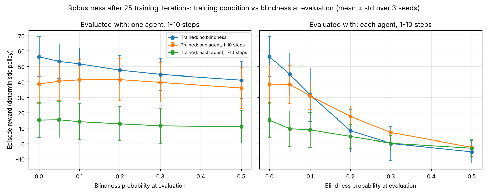

What this shows:

- **Training with blindness makes the team more robust, once trained.** After 100 iterations, the more blindness a policy saw in training, the better it holds up: at 10% each-agent blindness, the each-agent-trained policy keeps 86% of its unblinded reward, the one-agent-trained policy 71%, and the no-blindness policy 43%. The blindness-trained policies also vary far less between seeds.
- **It costs nothing when everyone can see.** With no blindness at evaluation, all three policies score about the same after 100 iterations (70–72).
- **But it slows learning.** After 25 iterations the blindness-trained policies were still well behind, which made blindness training look harmful. Judging robustness from a short training run would have given the opposite answer.
- **Many blind agents at once is still hard.** From 30% each-agent blindness, every policy keeps less than a third of its reward.

To reproduce: `python experiments/run_robustness.py . <seed> experiments/robustness_seed<seed>.json [n_iters]` for each seed (about 13 minutes per seed on one CPU core at 25 iterations, 40 at 100), merge the seed files into `experiments/robustness_results.json` (or `robustness_100iters_results.json`), then `python experiments/plot_robustness.py [results file]`.

### Beyond the original experiments: blindness-aware agents and a curriculum

Three ideas, each trained for 100 iterations with one random agent blinded for 1–10 steps (probability 0.1), 3 seeds, and evaluated exactly as in the robustness test (`experiments/run_variant.py`):

- **Blind flag:** each agent's observation gains a flag that is 1 while it's blind (`make_env(aware="flag")`).
- **Flag and memory:** a blind agent also keeps its last real observation instead of seeing zeros (`make_env(aware="memory")`), like a sensor that holds its last reading.
- **Curriculum:** the blindness probability rises from 0 to 0.1 over the first 50 iterations, then stays at 0.1.

| Trained with | One agent blind, p = 0.5 | Each agent blind, p = 0.1 | p = 0.2 | p = 0.5 |
|---|---|---|---|---|
| No blindness | 43.2 | 30.0 | 15.4 | −1.9 |
| One-agent blindness | 58.2 | 51.5 | 32.2 | 3.4 |
| Each-agent blindness | 65.0 | 61.7 | 43.1 | 5.7 |
| **One-agent blindness + flag and memory** | **70.2** | **67.6** | **63.1** | **41.1** |
| One-agent blindness + flag only | 52.9 | 43.2 | 11.8 | −1.6 |
| One-agent blindness, curriculum | 36.5 | 20.5 | 1.3 | −6.5 |
| **Each-agent blindness + flag and memory** | **75.8** | **74.7** | **70.7** | **51.6** |

Mean episode reward over 3 seeds. With no blindness, every policy scores 70–73, except the last one, which scores 78.

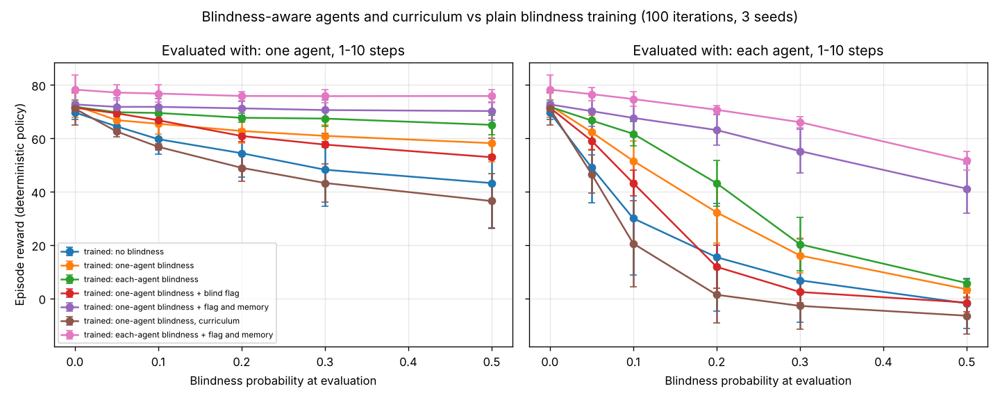

- **Memory makes the team far more robust.** With a blind agent keeping its last real observation, the team keeps 97% of its reward when one agent is blind half the time. When every agent can go blind 20% of the time, it scores 63 against at most 43 for any plain policy, even though it only trained with one agent blinded at a time. It costs nothing when no one is blind.
- **Memory with each-agent blindness training is best of all.** Trained with every agent able to go blind, the memory policy keeps 96% of its reward at each-agent p = 0.1 and 90% at p = 0.2, and also has the highest mean reward with no blindness (78 ± 5 vs 70–73), though with 3 seeds that last gap is within the spread.
- **A flag alone doesn't help.** Knowing you're blind, with nothing to act on, does slightly worse than plain blindness training.
- **The curriculum hurts.** Ramping blindness up means less blindness during training, and robustness falls to about the no-blindness policy's level.

**The scenarios that didn't learn** (wheel, ball_passage) still don't with a longer horizon (`gamma` 0.99, GAE λ 0.95) or more exploration (entropy 0.01), 100 iterations, 2 seeds each. They likely need reward shaping or a different setup.

To reproduce: `python experiments/run_variant.py <variant> <seed> <out.json>` (variants: `aware-flag`, `aware-memory`, `aware-memory-each`, `curriculum`, `stuck:<scenario>:<setting>`), merge into `experiments/variants_results.json`, then `python experiments/plot_variants.py`.

## 🚀 Getting Started

### Prerequisites

Python 3.11. The script uses the TorchRL API from late 2024, so `requirements.txt` pins the versions it was checked with.

### Installation

```bash
git clone https://github.com/morganwhite13/Improving-MARL-Robustness-for-Agent-Blindness-in-VMAS.git
cd Improving-MARL-Robustness-for-Agent-Blindness-in-VMAS
pip install -r requirements.txt

# Run the tests
pytest -q tests/
```

### Quick Start

```python
# Run the full set of experiments
python "MARL Robustness for Agent Blindness in VMAS.py"

# The script will train agents on multiple blindness scenarios
# and generate performance plots automatically
```

### Using the `marl_blindness` package

The training code is also available as a package, so one setting can be trained and evaluated without running every experiment in the script. With the same settings and seed it reproduces the script's results exactly (a test checks this). Install it with `pip install -e .` (Python 3.10 or 3.11), which also adds a `marl-blindness` command; `pip install -e ".[dev]"` adds pytest and ruff (`ruff check .` and `pytest` should both pass).

```bash
# Train with one agent blinded for 1-10 steps (probability 0.1), save the policy
python -m marl_blindness train --blindness one-steps --preset tuned --iters 100 --seed 0 \
    --out run.json --save-policy policy.pt

# Evaluate it on fresh episodes when every agent can go blind
python -m marl_blindness evaluate policy.pt --blindness each-steps --probs 0 0.1 0.2
```

```python
import torch
from marl_blindness import TUNED, evaluate, make_env, train

env = make_env(blindness="one-steps")
torch.manual_seed(0); env.set_seed(0)
result = train(env, TUNED.with_(n_iters=100))
score = evaluate(result.policy, lambda: make_env(blindness="each-steps", blind_prob=0.2), seed=1000)
```

Presets: `original` is the script's settings; `tuned` is the best configuration from the hyperparameter re-run (clip 0.3, 30 epochs), which scored 55.6 ± 1.8 against 21.3 ± 7.6 for `original` after 25 iterations. But a `tuned` iteration takes about 1.65× as long, so for a fixed amount of compute **`original` with more iterations is better**: given the same wall-clock time it reached 63.0 against 49.4 after 7 minutes, and a higher learning rate (1e-3) was worse than both (`experiments/run_efficiency.py`, plot below).

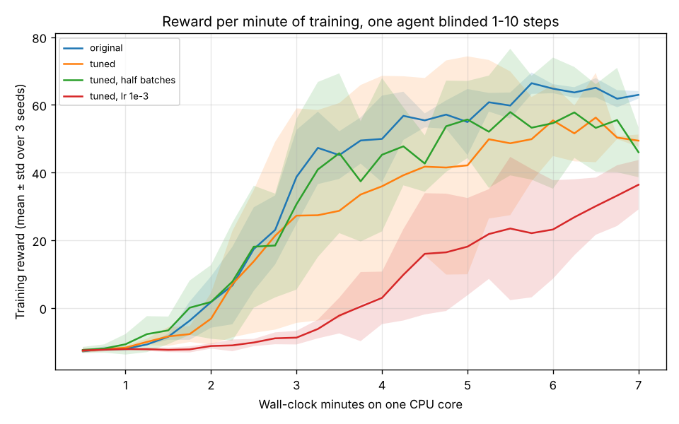 Blindness kinds: `none`, `one-every-step`, `all-every-step`, `one`, `each`, `one-steps`, `each-steps`.

### Training Custom Scenarios

```python
from torchrl.envs import TransformedEnv
from blindness import BlindOneRandomAgentIfProbabilityForJSteps
# train_environment_variables is defined in the main script, which runs every
# experiment when executed; experiments/run_exp1.py shows how to load the
# function and environments without running them

# Create environment with custom blindness
env = VmasEnv(scenario="balance", n_agents=3, ...)
env = TransformedEnv(
    env, 
    BlindOneRandomAgentIfProbabilityForJSteps(
        n_agents=3, 
        blind_prob=0.1,  # 10% chance per step
        max_blind_steps=10
    )
)

# Train with optimal hyperparameters
rewards, policy = train_environment_variables(
    env=env,
    description="Custom Blindness Test",
    norm=True,
    clipVal=0.3,
    batchSize=100,
    numEpochs=30
)

# Visualize trained policy
with torch.no_grad():
    env.rollout(
        max_steps=200,
        policy=policy,
        callback=lambda env, _: env.render()
    )
```

## 🏗️ Architecture

### MAPPO Algorithm

**Multi-Agent Proximal Policy Optimization** with:
- **Centralized critic**: Observes all agent states during training
- **Decentralized actors**: Each agent acts from local observations only
- **Parameter sharing**: Single policy network shared across all agents
- **PPO clipping**: Prevents drastic policy updates for training stability

### Network Architecture

```
Policy Network (Actor):
├── Input: Agent observation (n_obs_per_agent)
├── Hidden: 2 layers × 256 units (Tanh activation)
├── Output: 2 × n_actions (mean & std for continuous actions)
└── Distribution: TanhNormal (bounded continuous actions)

Critic Network:
├── Input: All agent observations (centralized)
├── Hidden: 2 layers × 256 units (Tanh activation)
└── Output: 1 state value per agent
```

### Training Pipeline

1. **Data Collection**: Parallel environments gather experiences
2. **GAE Computation**: Generalized Advantage Estimation for value targets
3. **Replay Buffer**: Store and sample minibatches
4. **PPO Updates**: Multiple optimization epochs per batch
5. **Policy Update**: Sync collector with trained policy weights

## 📁 Repository Structure

```
Improving-MARL-Robustness-for-Agent-Blindness-in-VMAS/
├── MARL Robustness for Agent Blindness in VMAS.py   # Experiments and MAPPO training
├── marl_blindness/                                  # Package: config presets, environments, training, evaluation, CLI
├── blindness.py                                     # Re-exports marl_blindness/blindness.py for existing imports
├── tests/test_blindness.py                          # Tests for the transforms
├── tests/test_experiments.py                        # Every plot script runs on the committed results
├── tests/test_package.py                            # The package reproduces the script; CLI, save and load
├── experiments/                                     # Re-runs and robustness test: scripts, results, plots
├── .github/workflows/tests.yml                      # Runs the tests in CI
├── README.md                                        # This file
├── LICENSE                                          # MIT License
└── requirements.txt                                 # Python dependencies
```

## 🔬 Experiments Conducted

The project includes comprehensive experiments across 7 dimensions:

1. **Baseline Comparison** - 7 blindness scenarios vs. normal environment
2. **Normalization Impact** - Advantage normalization on/off
3. **PPO Clipping** - 6 clip values (0.01 to 0.75)
4. **Batch Size** - 7 sizes (10 to 1000)
5. **Training Epochs** - 6 values (5 to 50)
6. **Blindness Probability** - 6 probabilities (0.01 to 0.50)
7. **Blindness Duration** - 7 max durations (1 to 20 steps)
8. **Agent Count** - 6 team sizes (2 to 10 agents)
9. **Scenario Generalization** - 5 VMAS scenarios
10. **Combined Optimization** - Best hyperparameter configurations

**Total Training Runs**: 50+ experiments, each 25 iterations × 6,000 frames

## 📈 Performance Metrics

### Robustness Thresholds

From the robustness test after 100 iterations, share of unblinded reward kept:

| Blindness at evaluation | Trained without blindness | Trained with each-agent blindness |
|---|---|---|
| One agent, p = 0.5 | 62% | 91% |
| Each agent, p = 0.1 | 43% | 86% |
| Each agent, p = 0.2 | 22% | 60% |
| Each agent, p = 0.3 | 10% | 28% |

The original single-seed runs had reported >70% up to p = 0.2 and a threshold near p = 0.3.

### Duration Sensitivity

From the Experiment 7 re-run (blindness probability 0.1, policy trained without blindness, share of unblinded reward kept):

- **One agent blind at a time:** 93% with spells up to 5 steps, 86% up to 10, 80% up to 20
- **Each agent can go blind:** 68% up to 5 steps, 43% up to 10, 22% up to 20
- A policy trained with blindness keeps more at every length: 84%, 71% and 49% for each-agent blindness

## 🛠️ Technical Stack

- **Framework**: TorchRL, VMAS (Vectorized Multi-Agent Simulator)
- **Deep Learning**: PyTorch 1.13+
- **Algorithm**: MAPPO (Multi-Agent PPO)
- **Environment**: VMAS Balance scenario + custom transforms
- **Optimization**: Adam optimizer with gradient clipping
- **Value Estimation**: Generalized Advantage Estimation (GAE)

## 🔮 Future Work

Potential extensions and improvements:

- **Communication protocols**: Allow agents to signal blindness states
- **Partial blindness**: Noisy observations instead of complete occlusion
- **Multi-algorithm comparison**: Implement MADDPG, QMIX for benchmarking
- **Curriculum learning**: Gradually increase blindness difficulty
- **Meta-learning**: Train agents to adapt quickly to new blindness patterns
- **Real robot deployment**: Test on physical drone/robot swarms
- **Adversarial blindness**: Opponent strategically targets agents
- **Multi-task training**: Train across multiple VMAS scenarios simultaneously

## 📄 License

This project is licensed under the MIT License - see the [LICENSE](LICENSE) file for details.

## 🙏 Acknowledgments

- **Matteo Bettini** and **Prorok Lab** (University of Cambridge) for VMAS framework
- **PyTorch and TorchRL teams** for excellent deep RL tools
- **Yu et al. (2022)** for "The Surprising Effectiveness of PPO in Cooperative Multi-Agent Games"

## 📞 Contact & Support

- [**Portfolio**](https://morganwhite13.github.io/)
- [**Email**](morgan13white@icloud.com)
- [**LinkedIn**](https://www.linkedin.com/in/morgan-white-95b245237/)

---
