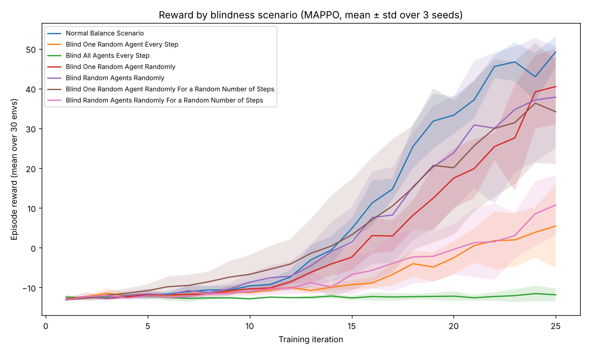

# Improving MARL Robustness for Agent Blindness in VMAS

A Multi-Agent Reinforcement Learning research project investigating how cooperative agents handle partial observability through random "blindness" events. This work demonstrates that MARL systems can learn robust coordination strategies despite unpredictable sensory failures.

[](https://www.python.org/downloads/)
[](https://pytorch.org/)


## 🎯 Overview

**The Challenge:** Autonomous systems must cooperate effectively even when sensors fail unexpectedly. This project explores whether multi-agent reinforcement learning can develop strategies that remain robust when agents randomly lose sensory input.

**Key Innovation:** Six custom blindness scenarios implemented as VMAS environment transforms, ranging from simple single-step occlusions to complex multi-agent, variable-duration sensory failures.

**Results:** Achieved 86% performance improvement over baseline through systematic hyperparameter optimization, with agents maintaining 84% of baseline performance even under 10% blindness probability.

### Real-World Applications

- **Autonomous vehicles** handling camera/sensor malfunctions
- **Drone swarms** maintaining formation during GPS signal loss
- **Robot teams** completing tasks with failed sensors
- **Satellite networks** coordinating during communication blackouts

## 🔬 Research Highlights

### Custom Blindness Scenarios

Implemented six environment transforms that randomly zero out agent observations:

1. **BlindOneRandomAgentEveryStep** - One agent blinded each step
2. **BlindAllAgentsEveryStep** - All agents simultaneously blinded
3. **BlindOneRandomAgentIfProbability** - Probabilistic single-agent blindness
4. **BlindRandomAgentsIfProbability** - Probabilistic multi-agent blindness
5. **BlindOneRandomAgentIfProbabilityForJSteps** - Extended duration single-agent blindness
6. **BlindRandomAgentsIfProbabilityForJSteps** - Extended duration multi-agent blindness (most realistic)

### Key Findings

The findings below come from the original single-seed runs, before the bug fixes described in "Known issues and status". The Experiment 1 re-run supports the first point; the others still need re-running.

- **Robustness is learnable**: Agents develop cooperative strategies that gracefully degrade under partial observability
- **Hyperparameters matter**: Optimal configuration (normalized advantages, clip=0.3, batch=100, epochs=30) yielded +86% performance
- **Advantage normalization is critical**: Essential for handling variance when agents experience different observation states
- **Redundancy helps**: 5-7 agents provide optimal balance between redundancy and coordination overhead
- **Performance thresholds exist**: Systems maintain function up to ~30% blindness probability before sharp degradation

## Known issues and status

The original results (the tables further down) were produced with code that had several bugs, all now fixed:

- `BlindAllAgentsEveryStep` picked a random agent (with replacement) on each loop pass, so it blinded about two of three agents, not all of them.
- `BlindRandomAgentsIfProbability` blinded a fresh random agent, not the agent that passed the probability check.
- `BlindRandomAgentsIfProbabilityForJSteps` ignored `max_blind_steps` and always drew durations from 1 to 10.
- Every transform made one random choice per step and applied it to all 30 parallel environments at once, kept blind countdowns per agent rather than per environment, and never reset them between episodes. The transforms now live in `blindness.py`, draw independently per environment, and are covered by tests in `tests/`.
- The blindness-probability and blind-duration sweeps wrapped the previous iteration's environment, so transforms stacked up across settings. Each setting now starts from a fresh base environment.
- The first plot read a `"norm"` key that its results did not have, so the script crashed after the first experiment.
- The "VMAS Scenarios" experiment could crash with "Physical actions ... out of its range": a `TanhNormal` sample can overshoot the action bound by floating-point error, which VMAS rejects. The policy now clamps actions into the spec (`safe=True`).

With these fixes, every experiment in the script has been run end to end with a reduced training budget (1 iteration each) to check that it completes.

Experiment 1 has been re-run with the fixed code over 3 seeds (below). The other experiments still need re-running. Two limitations remain: policies are scored on their own training rollouts rather than a separate evaluation, and with the default 25 iterations most reward curves are still rising, so training hasn't converged.

The reward rescaling in the blindness-probability and blind-duration plots is applied for display only, so those curves cannot be compared directly across settings.

## 📊 Experimental Results

### Experiment 1, re-run with the fixed code

Final episode reward (mean over the 30 parallel environments, last training iteration), mean ± standard deviation over 3 seeds. Same settings as the original experiment: `norm=False`, clip 0.2, 25 iterations × 6,000 frames, balance scenario with 3 agents.

| Blindness Scenario | Final Reward |
|-------------------|--------------|
| No blindness (baseline) | 49.2 ± 4.8 |
| Blind 1 random agent with probability 0.1 | 40.5 ± 11.6 |
| Blind each agent with probability 0.1 | 37.8 ± 15.6 |
| Blind 1 random agent for 1–10 steps (probability 0.1) | 34.2 ± 16.1 |
| Blind each agent for 1–10 steps (probability 0.1) | 10.7 ± 9.2 |
| Blind 1 random agent every step | 5.5 ± 12.9 |
| Blind all agents every step | −11.8 ± 1.9 |



What holds up: training without blindness does best, and blinding every agent prevents learning entirely. Occasional, short blindness costs relatively little, while persistent blindness (every step, or several agents for several steps) hurts much more. The spread between seeds is as large as the gaps between the middle scenarios, so their order isn't meaningful from 3 seeds.

These rewards are on a different scale from the original table below (about 50 rather than about 450 for the baseline). The re-run used the pinned versions in `requirements.txt`; the original runs may have used different library versions or reported reward differently.

To reproduce: `python experiments/run_exp1.py . <seed> experiments/seed<seed>.json` for each seed (about 45 minutes per seed on one CPU core), then `python experiments/plot_exp1.py`. The results used here are in `experiments/exp1_results.json`.

### Original results (before the fixes)

| Blindness Scenario | Final Reward | Performance vs. Baseline |
|-------------------|--------------|--------------------------|
| No blindness (baseline) | ~450 | 100% |
| Blind 1 agent randomly (1 step) | ~380 | 84% |
| Blind 1 agent every step | ~320 | 71% |
| Blind 1 agent random duration | ~280 | 62% |
| Blind random agents randomly | ~240 | 53% |
| Blind random agents random duration | ~180 | 40% |

### Hyperparameter Optimization

**Impact of Key Parameters:**
- **Normalization**: Essential (+40-60 reward improvement across scenarios)
- **Clip value**: Optimal at 0.3 (+28% over default 0.2)
- **Batch size**: Smaller batches (50-100) outperform default 200
- **Epochs**: Diminishing returns after 30 epochs
- **Agent count**: 5-7 agents optimal for robustness vs. coordination

**Best Configuration:**
```python
normalize_advantage = True
clip_epsilon = 0.3
minibatch_size = 100
num_epochs = 30
# Result: ~520 reward (+86% over baseline 280)
```

## 🚀 Getting Started

### Prerequisites

Python 3.11. The script uses the TorchRL API from late 2024, so `requirements.txt` pins the versions it was checked with.

### Installation

```bash
git clone https://github.com/morganwhite13/Improving-MARL-Robustness-for-Agent-Blindness-in-VMAS.git
cd Improving-MARL-Robustness-for-Agent-Blindness-in-VMAS
pip install -r requirements.txt

# Run the tests
pytest -q tests/
```

### Quick Start

```python
# Run the full set of experiments
python "MARL Robustness for Agent Blindness in VMAS.py"

# The script will train agents on multiple blindness scenarios
# and generate performance plots automatically
```

### Training Custom Scenarios

```python
from torchrl.envs import TransformedEnv
from blindness import BlindOneRandomAgentIfProbabilityForJSteps
# train_environment_variables is defined in the main script, which runs every
# experiment when executed; experiments/run_exp1.py shows how to load the
# function and environments without running them

# Create environment with custom blindness
env = VmasEnv(scenario="balance", n_agents=3, ...)
env = TransformedEnv(
    env, 
    BlindOneRandomAgentIfProbabilityForJSteps(
        n_agents=3, 
        blind_prob=0.1,  # 10% chance per step
        max_blind_steps=10
    )
)

# Train with optimal hyperparameters
rewards, policy = train_environment_variables(
    env=env,
    description="Custom Blindness Test",
    norm=True,
    clipVal=0.3,
    batchSize=100,
    numEpochs=30
)

# Visualize trained policy
with torch.no_grad():
    env.rollout(
        max_steps=200,
        policy=policy,
        callback=lambda env, _: env.render()
    )
```

## 🏗️ Architecture

### MAPPO Algorithm

**Multi-Agent Proximal Policy Optimization** with:
- **Centralized critic**: Observes all agent states during training
- **Decentralized actors**: Each agent acts from local observations only
- **Parameter sharing**: Single policy network shared across all agents
- **PPO clipping**: Prevents drastic policy updates for training stability

### Network Architecture

```
Policy Network (Actor):
├── Input: Agent observation (n_obs_per_agent)
├── Hidden: 2 layers × 256 units (Tanh activation)
├── Output: 2 × n_actions (mean & std for continuous actions)
└── Distribution: TanhNormal (bounded continuous actions)

Critic Network:
├── Input: All agent observations (centralized)
├── Hidden: 2 layers × 256 units (Tanh activation)
└── Output: 1 state value per agent
```

### Training Pipeline

1. **Data Collection**: Parallel environments gather experiences
2. **GAE Computation**: Generalized Advantage Estimation for value targets
3. **Replay Buffer**: Store and sample minibatches
4. **PPO Updates**: Multiple optimization epochs per batch
5. **Policy Update**: Sync collector with trained policy weights

## 📁 Repository Structure

```
Improving-MARL-Robustness-for-Agent-Blindness-in-VMAS/
├── MARL Robustness for Agent Blindness in VMAS.py   # Experiments and MAPPO training
├── blindness.py                                     # Blindness transforms
├── tests/test_blindness.py                          # Tests for the transforms
├── experiments/                                     # Experiment 1 re-run: script, results, plot
├── .github/workflows/tests.yml                      # Runs the tests in CI
├── README.md                                        # This file
├── LICENSE                                          # MIT License
└── requirements.txt                                 # Python dependencies
```

## 🔬 Experiments Conducted

The project includes comprehensive experiments across 7 dimensions:

1. **Baseline Comparison** - 7 blindness scenarios vs. normal environment
2. **Normalization Impact** - Advantage normalization on/off
3. **PPO Clipping** - 6 clip values (0.01 to 0.75)
4. **Batch Size** - 7 sizes (10 to 1000)
5. **Training Epochs** - 6 values (5 to 50)
6. **Blindness Probability** - 6 probabilities (0.01 to 0.50)
7. **Blindness Duration** - 7 max durations (1 to 20 steps)
8. **Agent Count** - 6 team sizes (2 to 10 agents)
9. **Scenario Generalization** - 5 VMAS scenarios
10. **Combined Optimization** - Best hyperparameter configurations

**Total Training Runs**: 50+ experiments, each 25 iterations × 6,000 frames

## 📈 Performance Metrics

### Robustness Thresholds

- **P(blind) < 0.2**: Graceful degradation, maintains > 70% performance
- **P(blind) = 0.3**: Critical threshold, ~59% performance
- **P(blind) > 0.5**: System failure, < 50% performance

### Duration Sensitivity

- **1-5 steps**: Minimal impact, agents compensate effectively
- **7-10 steps**: Moderate degradation, coordination suffers
- **20+ steps**: Severe disruption, often unrecoverable

## 🛠️ Technical Stack

- **Framework**: TorchRL, VMAS (Vectorized Multi-Agent Simulator)
- **Deep Learning**: PyTorch 1.13+
- **Algorithm**: MAPPO (Multi-Agent PPO)
- **Environment**: VMAS Balance scenario + custom transforms
- **Optimization**: Adam optimizer with gradient clipping
- **Value Estimation**: Generalized Advantage Estimation (GAE)

## 🔮 Future Work

Potential extensions and improvements:

- **Communication protocols**: Allow agents to signal blindness states
- **Partial blindness**: Noisy observations instead of complete occlusion
- **Multi-algorithm comparison**: Implement MADDPG, QMIX for benchmarking
- **Curriculum learning**: Gradually increase blindness difficulty
- **Meta-learning**: Train agents to adapt quickly to new blindness patterns
- **Real robot deployment**: Test on physical drone/robot swarms
- **Adversarial blindness**: Opponent strategically targets agents
- **Multi-task training**: Train across multiple VMAS scenarios simultaneously

## 📄 License

This project is licensed under the MIT License - see the [LICENSE](LICENSE) file for details.

## 🙏 Acknowledgments

- **Matteo Bettini** and **Prorok Lab** (University of Cambridge) for VMAS framework
- **PyTorch and TorchRL teams** for excellent deep RL tools
- **Yu et al. (2022)** for "The Surprising Effectiveness of PPO in Cooperative Multi-Agent Games"

## 📞 Contact & Support

- [**Portfolio**](https://morganwhite13.github.io/)
- [**Email**](morgan13white@icloud.com)
- [**LinkedIn**](https://www.linkedin.com/in/morgan-white-95b245237/)

---
